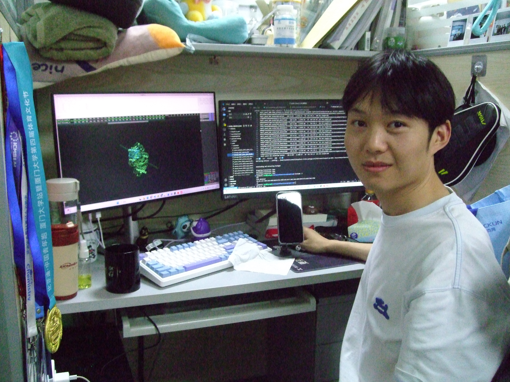
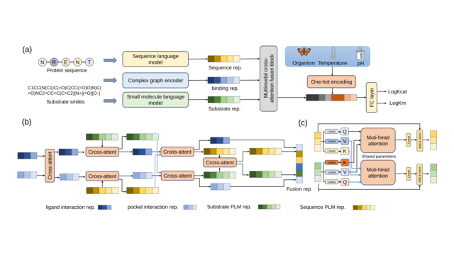
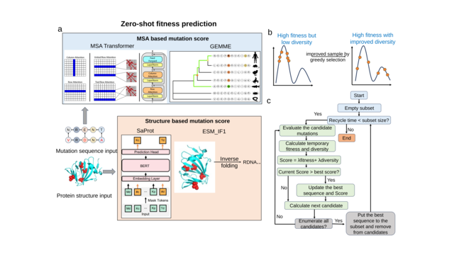
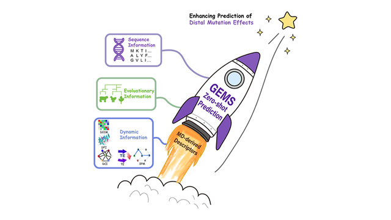
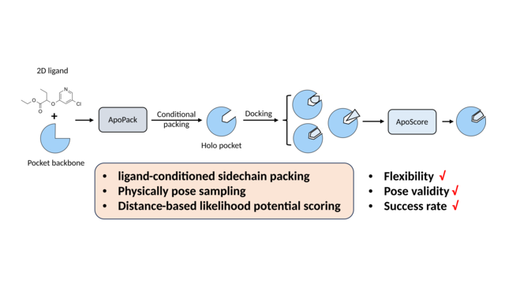
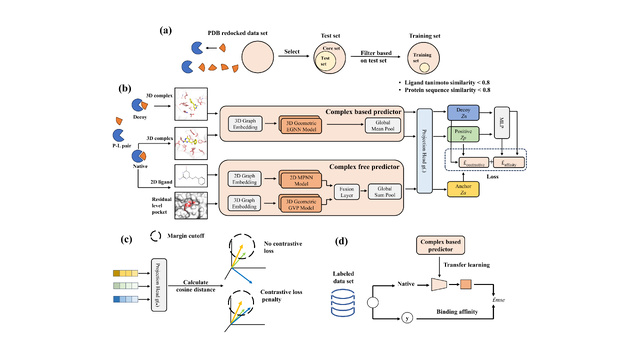
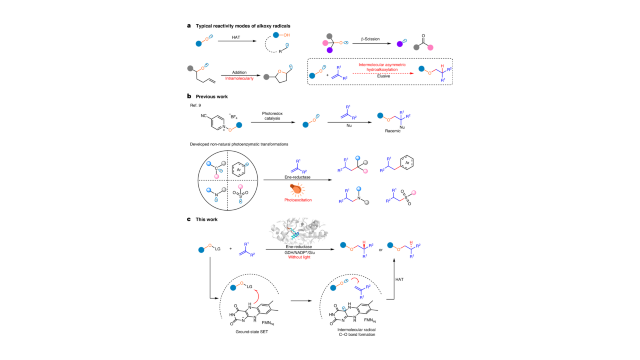

**Ding Luo &nbsp; 罗钉**

> <i class="fas fa-at"></i> &nbsp; dingluo AT illinois DOT edu 
> <i class="fas fa-link"></i> &nbsp; [<i class="fas fa-graduation-cap"></i> Google Scholar](https://scholar.google.com/citations?user=BlQHxToAAAAJ), [<i class="fab fa-github"></i> GitHub](https://github.com/ld139)

I am a **Postdoctoral Research Associate** in [Prof. Huimin Zhao's group](https://zhaogroup.chbe.illinois.edu/) at the [University of Illinois Urbana-Champaign (UIUC)](https://illinois.edu/). I received my Ph.D. in Physical Chemistry from the [College of Chemistry and Chemical Engineering](https://chem.xmu.edu.cn/), [Xiamen University](https://www.xmu.edu.cn/), in 2026, under the supervision of [Prof. Binju Wang](https://chem.xmu.edu.cn/info/1421/7656.htm).

---

## RESEARCH

My research focuses on developing AI-based computational tools for enzyme discovery and engineering, including enzyme function prediction, kinetic parameter modeling, and variant design. I am also interested in applying existing protein modeling and design tools to de novo enzyme design. My previous work includes computational studies of protein–ligand interactions and molecular simulations.

Key research topics include:

<ul style="margin-top: -10px; margin-bottom: 5px;">
<li>
AI-based methods for enzyme discovery, catalysis modeling, and variant engineering

[<a href="https://doi.org/10.1021/acscatal.6c03874">ACS Catal. 2026</a>,
<a href="https://doi.org/10.1002/anie.202521396">Angew. Chem. Int. Ed. 2026</a>,
<a href="https://doi.org/10.1021/acs.jctc.6c00829">JCTC 2026</a>]

</li>
<li>
Application of computational protein design tools to de novo enzyme design
</li>
<li>
Structure-based modeling of protein–ligand interactions, binding affinity, and flexibility

[<a href="https://doi.org/10.1021/acs.jctc.4c01636">JCTC 2025</a>,
<a href="https://doi.org/10.1021/acs.jcim.3c01961">JCIM 2024</a>,
<a href="https://doi.org/10.1021/acs.jctc.4c00653">JCTC 2024</a>]

</li>
</ul>

---

## FEATURED PUBLICATIONS

  

    

  

  

    
<a href="https://doi.org/10.1021/acscatal.6c03874">Enzyme Kinetic Parameter Prediction via Catalytic Pocket-Augmented Machine Learning</a>

    
<b>Ding Luo</b>&#35;, Huining Ji&#35;, Shuming Cheng&#35;, Kaiqi Wen, Xiaoyang Qu, Mingfeng Cao, Liang Hong, Binju Wang&#42;

    
<i>ACS Catal.</i> <b>2026</b>, 16(13), 12784–12801.

    
<a href="https://pubs.acs.org/doi/10.1021/acscatal.6c03874">[Article]</a><a href="https://github.com/ld139/GraphKcat">[Code]</a>

  

  

    

  

  

    
<a href="https://doi.org/10.1002/anie.202521396">A Multimodal Ensemble Framework for Optimal Mutant Prediction and Computational Enzyme Engineering</a>

    
<b>Ding Luo</b>&#35;, Huining Ji&#35;, Baodong Hu&#35;, Jinxing Cai&#35;, Kaiqi Wen, Xiaoyang Qu, Mingfeng Cao, Xinrui Zhao&#42;, Binju Wang&#42;

    
<i>Angew. Chem. Int. Ed.</i> <b>2026</b>, 65(6), e21396.

    
<a href="https://onlinelibrary.wiley.com/doi/10.1002/anie.202521396">[Article]</a><a href="https://github.com/ld139/GEMS">[Code]</a>

  

  

    

  

  

    
<a href="https://doi.org/10.1021/acs.jctc.6c00829">Prediction of Distal Mutation Effects in Enzymes via Integration of Molecular Dynamics Descriptors and Zero-Shot Model</a>

    
Yiqiu Wang&#35;, <b>Ding Luo</b>&#35;, Shuming Cheng, Binju Wang&#42;

    
<i>J. Chem. Theory Comput.</i> <b>2026</b>, published online August 10, 2026.

    
<a href="https://pubs.acs.org/doi/10.1021/acs.jctc.6c00829">[Article]</a>

  

  

    

  

  

    
<a href="https://doi.org/10.1021/acs.jctc.4c01636">Ligand-Conditioned Side Chain Packing for Flexible Molecular Docking</a>

    
<b>Ding Luo</b>, Xiaoyang Qu, Dexin Lu, Yiqiu Wang, Lina Dong, Binju Wang&#42;

    
<i>J. Chem. Theory Comput.</i> <b>2025</b>, 21(3), 1494–1505.

    
<a href="https://pubs.acs.org/doi/10.1021/acs.jctc.4c01636">[Article]</a><a href="https://github.com/ld139/ApoDock_public">[Code]</a>

  

  

    

  

  

    
<a href="https://doi.org/10.1021/acs.jcim.3c01961">Enhancing Generalizability in Protein–Ligand Binding Affinity Prediction with Multimodal Contrastive Learning</a>

    
<b>Ding Luo</b>, Dandan Liu, Xiaoyang Qu, Lina Dong, Binju Wang&#42;

    
<i>J. Chem. Inf. Model.</i> <b>2024</b>, 64(6), 1892–1906.

    
<a href="https://pubs.acs.org/doi/10.1021/acs.jcim.3c01961">[Article]</a><a href="https://github.com/ld139/ConBAP">[Code]</a>

  

  

    

  

  

    
<a href="https://doi.org/10.1038/s41929-025-01372-z">Steering Oxygen-Centred Radicals with Ground-State Ene-Reductases for Enantioselective Intermolecular Hydroalkoxylations</a>

    
Bin Chen&#35;, Qiaoyu Zhang&#35;, Jinhai Yu&#35;, Beibei Zhao, Ran Ge, Zihan Zhang, <b>Ding Luo</b>, Binju Wang&#42;, Xiaoqiang Huang&#42;

    
<i>Nat. Catal.</i> <b>2025</b>, 8, 740–748.

    
<a href="https://www.nature.com/articles/s41929-025-01372-z">[Article]</a><a href="https://github.com/ld139/QSAR_enz">[Code]</a>

  

---

## ADDITIONAL SELECTED PUBLICATIONS

### Enzyme Catalysis & Biocatalysis

1. **Improved Catalytic Efficiency of P450 OleP for Converting Lithocholic Acid into Murideoxycholic and Ursodeoxycholic Acids through Semi-Rational and Rational Design.**  

   Baodong Hu, Cuiping Pang, **Ding Luo**, Yongchao Wang, et al.  

   **Synth. Syst. Biotechnol.**, published online in 2026.

2. **Biosynthesis of Diverse Ephedra-Type Alkaloids via a Newly Identified Enzymatic Cascade.**  

   Peiling Wu, **Ding Luo**, Yuezhou Wang, Xiaoxu Shang, Binju Wang, Xianming Deng, Jifeng Yuan&#42;.  

   **BioDesign Res.** **2024**, 6, 0048.  

   [[Article](https://doi.org/10.34133/bdr.0048)]

### Protein–Ligand Modeling

1. **A Robust Induced Fit Docking Approach with the Combination of the Hybrid All-Atom/United-Atom/Coarse-Grained Model and Simulated Annealing.**  

   Dexin Lu, **Ding Luo**, Yuwei Zhang, Binju Wang&#42;.  

   **J. Chem. Theory Comput.** **2024**, 20(14), 6414–6423.  

   [[Article](https://doi.org/10.1021/acs.jctc.4c00653)]

### Molecular Simulations

1. **Computational Strategies towards Developing Novel SARS-CoV-2 Mpro Inhibitors against COVID-19.**  

   **Ding Luo**, Jian-Bo Tong&#42;, Xing Zhang, Xue-Chun Xiao, Shuai Bian.  

   **J. Mol. Struct.** **2022**, 1247, 131378.

2. **Theoretically Exploring Selective-Binding Mechanisms of BRD4 through Integrative Computational Approaches.**  

   **Ding Luo**, Jian-Bo Tong&#42;, Xue-Chun Xiao, Shuai Bian, Xing Zhang, Jie Wang, Hai-Yin Xu.  

   **SAR QSAR Environ. Res.** **2021**, 32(12), 985–1011.

3. **3D-QSAR and Molecular Docking Analysis for Natural Aurone Derivatives as Anti-Malarial Agents.**  

   **Ding Luo**, Jian-Bo Tong&#42;, Yi Feng.  

   **Polycycl. Aromat. Compd.** **2022**, 42(9), 6017–6032.

### Other Topics

1. **Mechanistic Effects of Solvent Systems on the Ni–Sn-Catalyzed Hydrodeoxygenation of Lignin Derivatives to None-Oxygenates.**  

   Han He, **Ding Luo**, Hao Ma, Shuqian Xia&#42;.  

   **Catal. Sci. Technol.** **2022**, 12, 154–166.

&#42; Corresponding author  

&#35; Equal contribution

Last updated: November 2026

